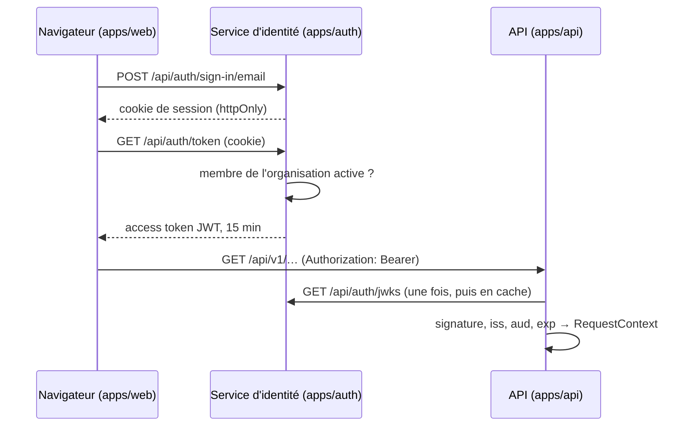

# Architecture : authentification

Comment un utilisateur prouve qui il est et pour quel tenant il agit, et pourquoi c'est découpé ainsi. Les règles sont dans [`AGENTS.md`](../../AGENTS.md#authentification) ; le mode d'emploi en local, dans [Authentification en local](../guides/auth-en-local.md).

## Le découpage

Deux credentials, deux rôles :

- **Le cookie de session** prouve l'identité auprès du service d'identité, et de lui seul. Il est `httpOnly`, donc illisible par le JavaScript de la page.
- **L'access token** prouve l'identité et le tenant auprès de l'API. C'est un JWT signé de 15 minutes que l'API vérifie seule, avec les clés publiques du service (JWKS), sans l'appeler à chaque requête.

### Pourquoi un service à part

- **L'API ne dépend que d'un contrat**, pas d'une bibliothèque d'authentification : un JWT signé, avec `iss`, `aud`, un `sub` et un tenant en UUID. Remplacer Better Auth par Keycloak, Auth0 ou Cognito ne demande que de la configuration (`AUTH_JWKS_URL`, `AUTH_TENANT_CLAIM`, `AUTH_ROLES_CLAIM`) ; `apps/auth` et `libs/web/auth` deviennent alors inutiles. Voir [Changer de fournisseur](../guides/auth-en-local.md#changer-de-fournisseur).
- **Les données d'identité restent à part** : mots de passe, sessions et clés privées sont dans le schéma Postgres `auth`, que l'API ne lit jamais.
- **Chacun évolue à son rythme** : le service d'identité se déploie et se met à l'échelle séparément, et ses migrations ne font qu'ajouter (Better Auth ne supprime rien).

### Pourquoi un JWT court plutôt qu'une session vérifiée à chaque appel

L'API vérifie le token localement : pas d'aller-retour vers le service d'identité à chaque requête, et une API qui continue de répondre si ce service tombe. La contrepartie est qu'un token émis reste valable jusqu'à son expiration, même si l'utilisateur est retiré de l'organisation entre-temps. Quinze minutes bornent ce délai, et le front renouvelle le token sans que l'utilisateur s'en aperçoive.

## Le service d'identité

`apps/auth` : Better Auth dans un serveur HTTP Node minimal (pas Nest), avec deux plugins.

- **`organization`** : une organisation Better Auth est un tenant. Ses membres ont un rôle `owner`, `admin` ou `member` ; les invitations partent par email, avec un lien vers le front (`AUTH_APP_URL`).
- **`jwt`** : signe les access tokens (`GET /api/auth/token`) et publie les clés publiques (`GET /api/auth/jwks`). Algorithme par défaut de Better Auth : EdDSA (Ed25519). Les clés privées sont stockées en base, chiffrées avec `BETTER_AUTH_SECRET`.

Autres choix :

- **Identifiants en UUID** (`generateId: 'uuid'`) : l'API attend des UUID pour `sub` et pour le tenant.
- **Email vérifié obligatoire** avant la première connexion. Les emails partent en arrière-plan : la durée de la réponse ne révèle pas si un compte existe, et un SMTP lent ne bloque pas la requête.
- **Anti-brute-force** : limites par défaut de Better Auth (3 tentatives de connexion par 10 s et par IP), actives en production, compteurs en base pour être partagés entre instances. L'IP vient du socket, ou de `X-Forwarded-For` derrière `TRUST_PROXY_HOPS` proxys ; toute valeur envoyée par le client dans l'en-tête interne est écrasée.
- **CORS** : origine explicite (`CORS_ORIGINS`), jamais `*`, puisque le front envoie ses cookies.

## Le contenu du token

Construit par `apps/auth/src/claims.ts`, à chaque émission :

| Claim               | Valeur                                                                                                                  |
| ------------------- | ----------------------------------------------------------------------------------------------------------------------- |
| `sub`               | ID de l'utilisateur (UUID)                                                                                              |
| `tenant_id`         | organisation active de la session, **seulement si l'utilisateur en est encore membre** (relu en base à chaque émission) |
| `roles`             | `['staff']` si le membre est `owner` ou `admin`, sinon `[]`                                                             |
| `email`             | seulement s'il est vérifié                                                                                              |
| `iss`, `aud`, `exp` | `AUTH_JWT_ISSUER`, `AUTH_JWT_AUDIENCE`, émission + 15 min                                                               |

Rien d'autre : le token circule et se journalise facilement, il ne porte pas de donnée personnelle inutile.

À la création d'une session, la première organisation de l'utilisateur (par date d'adhésion) devient active : le token porte un tenant dès la connexion. Changer d'organisation (`organization/set-active`) change le tenant des tokens suivants.

Un utilisateur sans organisation obtient un token sans `tenant_id`. L'API le refuse (401) : le front le redirige vers la création d'une organisation.

## La vérification dans l'API

`libs/api/core/src/lib/auth` : un `AuthGuard` global refuse toute requête sans token valide, sauf sur une route `@Public()`.

1. Le token est lu dans `Authorization: Bearer`.
2. `JwtVerifier` vérifie la signature, `iss`, `aud` et `exp` (jose). Avec un JWKS, seuls EdDSA, ES256 et RS256 sont acceptés : l'en-tête du token ne choisit jamais l'algorithme.
3. Le tenant et les rôles sont lus dans les claims configurées (`AUTH_TENANT_CLAIM`, `AUTH_ROLES_CLAIM`) : nom exact d'abord (claims préfixées par une URL), puis chemin pointé (`realm_access.roles`). `sub` et le tenant doivent être des UUID. Un rôle inconnu de l'application est ignoré, jamais interprété.
4. Le résultat devient le `Principal` du `RequestContext` (`userId`, `tenantId`, `roles`, `email`), et le logger de la requête reçoit `tenantId` et `userId`.

Tout échec donne un 401 `UNAUTHENTICATED`, sans détail sur la cause.

**Clés et pannes du fournisseur** : les clés téléchargées restent en cache. Un `kid` inconnu (rotation) relance le téléchargement, au plus toutes les 30 s, avec un timeout de 5 s. Si le service d'identité est injoignable, les tokens signés par une clé déjà connue passent toujours ; seuls ceux d'une clé inconnue échouent (401, journalisé en `warn` : ce n'est pas la faute du client).

**Rotation des clés** : Better Auth n'en fait pas par défaut (`rotationInterval` non configuré). Une rotation ajoute une clé au JWKS ; l'ancienne reste publiée pendant la période de grâce, le temps que les tokens qu'elle a signés expirent. Ne jamais changer `BETTER_AUTH_SECRET` : il chiffre les clés privées, qui deviendraient illisibles.

## Le front

- **Token en mémoire seulement** (`libs/web/data-access`, `access-token.ts`), jamais dans `localStorage` : un script injecté pourrait l'y lire. Il est renouvelé une minute avant son expiration ; des appels simultanés partagent un seul renouvellement.
- **Un 401 de l'API** déclenche un seul nouvel essai avec un token neuf. Le rejouer est sans risque : un 401 n'a rien exécuté, et l'`Idempotency-Key` est la même.
- **Connexion, déconnexion, organisation créée ou rejointe** : le token et tout le cache de données sont vidés, car ils appartenaient à l'ancien utilisateur ou à l'ancien tenant.
- **Routes protégées** (`_authenticated`) : session et organisation active exigées, sinon redirection vers la connexion ou la création d'organisation.

## En dev et en test

`AUTH_JWT_SECRET` remplace le JWKS : un secret HS256 partagé, avec lequel `pnpm -s dev:token` et `signTestToken` (`api-core/testing`) fabriquent des tokens de même forme que ceux du fournisseur. Pas de service d'identité à lancer, et des tokens pour n'importe quel tenant ou rôle.

Ce mode est refusé en production : un secret partagé permet de fabriquer des tokens. `AUTH_JWKS_URL` et `AUTH_JWT_SECRET` sont exclusifs, l'API refuse de démarrer avec les deux.

Côté front, `VITE_DEV_TOKEN` fait de même : l'app appelle l'API avec ce token, sans connexion. Il n'est lu qu'en mode dev et n'atteint jamais un build de production.

## Limites connues

- **Révocation** : un token reste valable jusqu'à 15 minutes après le retrait d'un membre ou la fin de sa session. Pour une coupure immédiate, il faudrait une liste de révocation consultée par l'API, que le boilerplate n'a pas.
- **Un tenant par token** : un utilisateur membre de plusieurs organisations agit dans une seule à la fois, celle de la session.
- **Rate limiting de Better Auth inactif hors production** : en dev, rien ne limite les tentatives de connexion.
