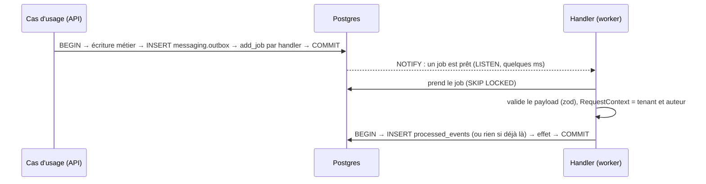

# Architecture : outbox et événements

Comment un domaine annonce un fait et comment les autres y réagissent, avec quelles garanties. Les règles sont dans [`AGENTS.md`](../../AGENTS.md#événements-dintégration-outbox--graphile-worker) ; un handler écrit pas à pas, dans [Référence : un domaine de l'API](../reference/domaine-api.md#réagir-à-un-événement).

## Façade ou événement

Deux façons pour un domaine d'en utiliser un autre :

- **La façade**, pour lire ou commander de façon synchrone : les commandes demandent au catalogue le prix des produits avant d'enregistrer. Le domaine appelant dépend du domaine appelé.
- **L'événement**, pour réagir après coup : le catalogue compte les ventes quand une commande est passée. Le domaine qui réagit ne dépend que du contrat de l'événement, jamais du domaine émetteur.

L'événement inverse donc la dépendance : les commandes dépendent du catalogue (façade), et le catalogue réagit aux commandes sans dépendre d'elles. Un nouveau consommateur s'ajoute sans toucher à l'émetteur.

## Le parcours



### 1. Déclarer

Dans `libs/shared/contracts/src/lib/<domaine>/<domaine>.events.ts` :

```ts
export const OrderPlaced = defineIntegrationEvent(
  'orders.order-placed.v1',
  z.object({ orderId: orderIdSchema, customerId: z.uuid(), customerEmail: z.email().nullable(), lines: … }),
);
```

- Le type suit `<domaine>.<fait-au-passé>.v<n>`, vérifié au démarrage.
- Le schéma zod est le contrat : le payload est validé à la publication et à la consommation.
- Le payload porte tout ce dont les consommateurs ont besoin (_event-carried state transfer_) : aucun ne rappelle le domaine émetteur pour compléter.

### 2. Publier

Dans le cas d'usage, dans la même transaction que l'écriture métier :

```ts
await this.transactions.transaction(async () => {
  await this.orders.insert(order);
  await this.outbox.publish(OrderPlaced, { orderId: order.id, … });
});
```

L'événement est écrit dans `messaging.outbox`, et un job par handler abonné est mis en file par `graphile_worker.add_job`, dans la même transaction que la donnée : tout est validé ensemble, ou rien. La file vit dans Postgres, dans le schéma `graphile_worker` ([ADR 0012](adr/0012-file-de-jobs-graphile-worker.md)) ; `messaging.outbox` reste le journal des événements, gardé 7 jours. Hors transaction, `publish` refuse (`OUTBOX_REQUIRES_TRANSACTION`) : l'événement pourrait survivre à une écriture annulée. La transaction en cours est portée par AsyncLocalStorage (`DatabaseSession`) : repository et outbox écrivent dans la même sans se la passer.

L'enveloppe ajoute au payload un ID (`EVT-…`, triable par date), le type, le tenant et l'auteur (lus dans `RequestContext`), la date, et le contexte de trace de la requête.

### 3. Mettre en file

`publish` crée **un job par couple (événement, handler)**, sous la clé `<event.id>:<handler>`. Chaque handler réessaie ainsi indépendamment des autres : un email en échec ne fait pas recompter les ventes.

- **Pas de relais** : le job existe dès la validation de la transaction. Le commit déclenche un `NOTIFY` qui réveille un worker en quelques millisecondes.
- **Un événement sans handler** est écrit dans le journal sans créer de job.
- **Rattrapage** : une tâche planifiée (`messaging:relay-pending`, chaque minute) met en file les lignes restées non publiées, celles qu'écrit encore une ancienne version pendant un déploiement. `FOR UPDATE SKIP LOCKED` répartit les lignes entre workers, et la clé du job écarte un doublon.

### 4. Traiter

Le worker (`IntegrationEventWorker`, Graphile Worker avec `JOBS_CONCURRENCY` jobs en parallèle par process, sur son propre pool Postgres) :

1. retrouve le handler par son nom ; inconnu, le job est réessayé (pendant un déploiement, un ancien worker peut recevoir le job d'un handler qu'il n'a pas encore) ;
2. valide le payload avec le schéma du contrat ; invalide, échec sans retry (le rejouer ne le corrigera pas) ;
3. exécute le handler au nom du tenant et de l'auteur de l'événement (`RequestContext.runAs`), **sans rôle** ;
4. pose la marque d'idempotence (`messaging.processed_events`, clé `(handler, event_id)`).

Le handler tourne sans rôle : il passe par les repositories (filtrés par tenant), pas par les cas d'usage, dont les règles d'accès visent l'utilisateur d'une requête. Voir [Multi-tenant et autorisations](multi-tenant-et-autorisations.md#handlers-dévénements).

## Garanties

### Au moins une fois, effet en base une seule fois

La livraison est garantie **au moins une fois** : un événement écrit finit par être traité, mais peut l'être plusieurs fois (worker tué en plein traitement, retry, rattrapage). Trois niveaux de déduplication :

| Niveau                           | Protège contre                                            | Durée                                                                      |
| -------------------------------- | --------------------------------------------------------- | -------------------------------------------------------------------------- |
| clé du job (`job_key`)           | un même couple (événement, handler) mis en file deux fois | tant que le job est en file (supprimé au succès, 7 jours après un abandon) |
| `processed_events`               | un même événement traité deux fois par un handler         | 30 jours                                                                   |
| clé d'idempotence du fournisseur | un appel externe rejoué (handler `transactional: false`)  | celle du fournisseur                                                       |

**Handler transactionnel** (par défaut) : la marque et les écritures du handler sont dans la même transaction. Si le handler échoue, la marque est annulée avec lui et le retry recommence ; s'il réussit, un second passage trouve la marque et ne fait rien. L'effet en base a lieu exactement une fois.

**Handler `transactional: false`**, pour un handler qui appelle surtout un service externe (email, API de paiement) : il s'exécute hors transaction, pour ne pas garder une connexion Postgres pendant l'appel, et la marque est posée après succès. Un crash entre l'appel et la marque fait rejouer l'appel : passer `event.id` comme clé d'idempotence au fournisseur (le `Mailer` en fait le `Message-ID` de l'email).

### Pas d'ordre

**L'ordre de traitement n'est pas garanti**, ni entre événements, ni entre handlers. Les jobs sont créés dans l'ordre d'écriture, mais plusieurs workers, plusieurs jobs en parallèle et des retries indépendants mélangent tout. Un `order-cancelled` peut être traité avant le `order-placed` de la même commande si ce dernier a échoué une fois.

Un handler doit donc supporter l'ordre inverse. Les handlers du catalogue appliquent des deltas qui commutent (`+n` puis `-n`, ou l'inverse), avec un compteur qui ne descend jamais sous zéro. Quand l'ordre compte vraiment, porter une version ou une date dans le payload et ignorer un événement plus ancien que l'état connu.

### Retries et abandon

10 tentatives, avec le backoff exponentiel de Graphile Worker (e^n secondes : 3 s, 7 s, 20 s… 2 h 15) : environ 3 h 30 avant l'abandon. Un payload invalide est abandonné tout de suite, puisque le rejouer ne le corrigera pas. Un job abandonné :

- reste 7 jours dans `graphile_worker.jobs`, avec sa dernière erreur (`last_error`), sauf un payload invalide, dont le job est terminé (l'événement reste dans l'outbox) ;
- incrémente `integration_events.jobs.exhausted` et part chez Sentry avec le handler, l'ID de l'événement et le tenant ;
- n'est rejoué par personne : l'effet n'a pas eu lieu, c'est à traiter (corriger, puis relancer le job avec `rescheduleJobs` des `WorkerUtils` de Graphile, ou réappliquer l'effet).

Un échec suivi d'un retry réussi n'est qu'un avertissement dans les logs. Les alertes à poser : [Référence : métriques et alertes](../reference/metriques-et-alertes.md).

### Rétention

Une purge quotidienne (`messaging:cleanup`, 3 h, dans la crontab de Graphile) supprime les lignes d'outbox publiées depuis 7 jours, les marques d'idempotence de plus de 30 jours (bien au-delà de la fenêtre de retries), les clés `Idempotency-Key` expirées et les jobs abandonnés depuis 7 jours. Un job réussi est supprimé tout de suite. Une ligne d'outbox jamais publiée n'est jamais purgée.

## Faire évoluer

### Un handler

- **Son nom** (`@OnIntegrationEvent(…, { name })`) est sa clé d'idempotence et une partie de la clé de ses jobs : il ne change pas. Le renommer laisse les jobs encore en file sous l'ancien nom se réessayer puis s'épuiser (signalés comme abandonnés, environ 3 h 30 plus tard).
- **Ajouter un handler** à un événement existant : il reçoit les événements publiés après son déploiement, pas les anciens. Aucun rattrapage automatique ; un historique se reconstruit par un script, depuis les données du domaine émetteur.
- **Supprimer un handler** : attendre que la file n'ait plus de job à son nom, ou accepter que ceux qui restent échouent.

### Un événement : `v1` → `v2`

Une version publiée ne change plus : un champ retiré ou dont le sens change casserait les consommateurs et les événements déjà dans l'outbox. Ajouter un champ optionnel est compatible et ne demande pas de nouvelle version ; tout le reste, si.

`orders.order-placed.v1` et `orders.order-placed.v2` sont deux types distincts, avec deux définitions, deux schémas et des handlers séparés. Pour passer de l'un à l'autre sans perte :

1. **Déclarer `v2`** à côté de `v1` dans les contrats.
2. **Consommateurs d'abord** : chaque consommateur ajoute un handler pour `v2` (nouveau nom, ex. `catalog.record-sales-v2`) et garde celui de `v1`. Une classe ne porte qu'un `@OnIntegrationEvent` : deux classes.
3. **Puis l'émetteur** publie `v2` à la place de `v1`. Les deux handlers d'un consommateur ne voient jamais le même fait : il est publié sous une seule version.
4. **Retirer `v1`** une fois la file vidée de `v1` (après la fenêtre de retries) : ses handlers, puis sa définition.

Déployer l'émetteur avant les consommateurs ferait publier des `v2` sans handler : aucun job ne serait créé, et ces événements seraient perdus pour ces consommateurs.

## Tester

- **Cas d'usage** : `RecordingOutbox` et `InlineTransactionManager` (`api-core/testing`) ; on vérifie les événements publiés (`outbox.ofType(OrderPlaced)`), payload validé compris.
- **Handler** : appelé directement, avec ses repositories en mémoire et un `RequestContext` de test.
- **Bout en bout** : Postgres réel (Testcontainers, migrations de Graphile comprises), et `eventually()` pour attendre le traitement asynchrone. Le test de référence du mécanisme : `libs/api/core/src/lib/events/messaging.int.spec.ts`.

## Limites connues

- **Pas d'ordre** (voir plus haut).
- **Pas de rattrapage** pour un nouveau handler.
- **Handler `transactional: false`** : la marque est lue puis posée, pas atomiquement. Deux exécutions simultanées du même job (job verrouillé trop longtemps que Graphile libère pendant que le premier finit) peuvent appeler deux fois le service externe : la clé d'idempotence du fournisseur est la dernière défense.
- **Un seul Postgres** : l'outbox suppose que l'écriture métier, l'événement et ses jobs sont dans la même base, ce qui est le cas de tous les domaines de l'API.
- **Connexion directe** : le worker écoute par `LISTEN`, qui ne passe pas par un pooler en mode transaction (PgBouncer, poolers managés). Derrière un pooler, son `DATABASE_URL` doit le contourner.
- **Charge sur Postgres** : chaque job est une insertion puis une suppression ; autovacuum à surveiller au-delà de quelques centaines de jobs par seconde.
