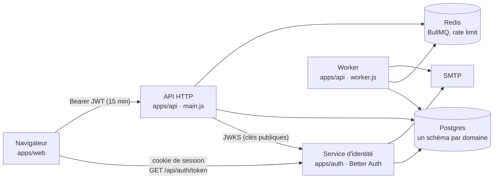
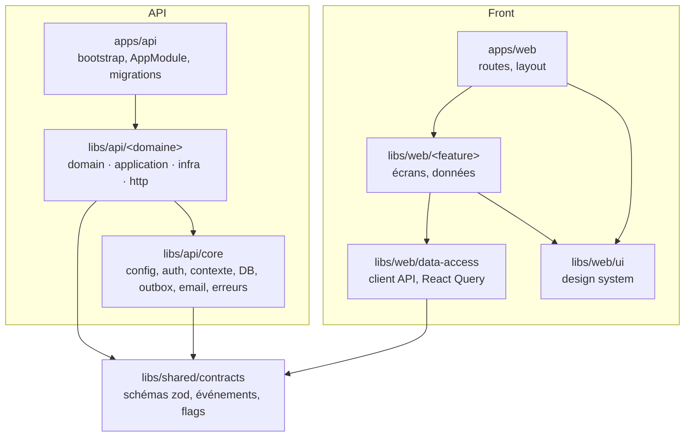
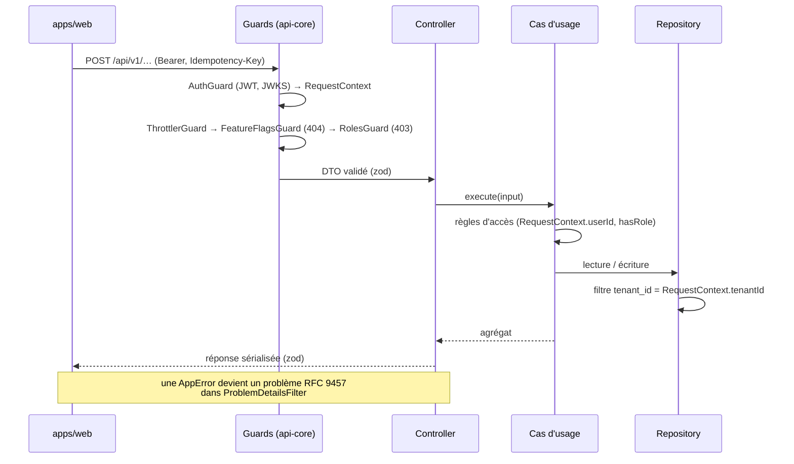
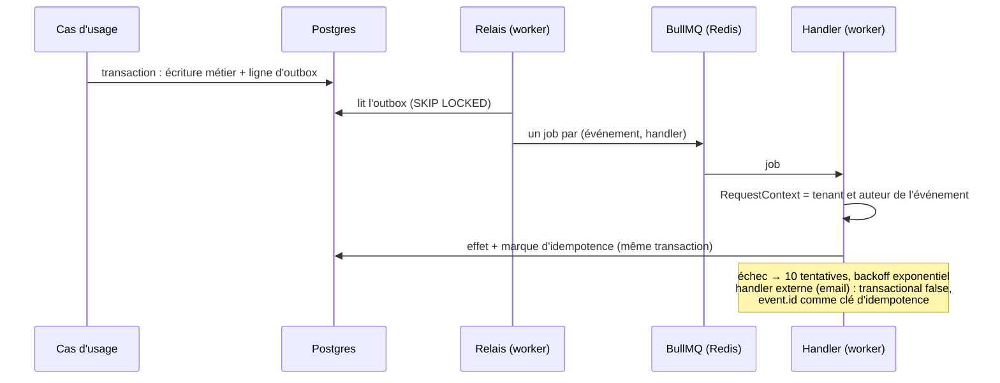

# Architecture : vue d'ensemble

Comment les morceaux du boilerplate s'assemblent. Chaque règle évoquée ici est détaillée dans [`AGENTS.md`](../../AGENTS.md), qui fait foi ; cette page donne la carte.

## Services

- **`apps/web`** : une SPA React (Vite) qui ne parle qu'à deux services. Elle obtient un access token du service d'identité avec son cookie de session, le garde en mémoire et l'envoie à l'API.
- **`apps/auth`** : Better Auth dans son propre process. Il gère les comptes, les organisations (une organisation = un tenant) et signe les JWT, et il expose ses clés publiques (JWKS). Ses tables sont dans le schéma Postgres `auth`.
- **`apps/api`** : une seule image, trois commandes. `main.js` sert le HTTP, `worker.js` fait tourner le relais de l'outbox et les handlers d'événements, `migrate.js` applique les migrations au déploiement. En dev, `nx serve api` fait tout dans un seul process.
- **Postgres** : chaque domaine a son schéma, du nom du domaine (`pgSchema('<domaine>')`), sans jointure ni clé étrangère vers un autre domaine. `api-core` y ajoute `messaging` (outbox, marques d'idempotence des handlers) et `idempotency` (réponses rejouées des routes `@Idempotent`).
- **Redis** : files BullMQ et compteurs du rate limiting. Toute clé a un TTL.

## Les libs et leurs dépendances

Les tags Nx (`scope:*`, `type:*`) font respecter ces flèches au lint. Un domaine n'importe d'un autre domaine que sa façade (`index.ts`), à travers un port et un adapter. `core` ne connaît aucun domaine. Le front et l'API partagent les schémas des contrats : une entrée validée par le formulaire l'est aussi par l'API.

## Le trajet d'une requête

Le tenant ne vient jamais de la requête : il est lu dans le token et placé dans `RequestContext` (AsyncLocalStorage). Chaque repository filtre dessus. Une ressource qu'on n'a pas le droit de voir répond 404, comme si elle n'existait pas.

## Le trajet d'un événement

L'événement est écrit dans la même transaction que la donnée métier : il n'y a pas d'événement sans effet, ni d'effet sans événement. La livraison est garantie au moins une fois, et la marque d'idempotence ne laisse passer qu'une fois un effet en base. Un domaine qui réagit ne dépend que du contrat de l'événement (`libs/shared/contracts`), jamais du domaine émetteur.

## Ce qui est transverse (`api-core`)

| Besoin                          | Ce qu'on utilise                                                                                                 |
| ------------------------------- | ---------------------------------------------------------------------------------------------------------------- |
| Qui appelle, pour quel tenant   | `RequestContext` (`userId`, `tenantId`, `hasRole`, `principal.email`)                                            |
| Route publique ou réservée      | `@Public()`, `@RequireRole('staff')`                                                                             |
| Fonctionnalité derrière un flag | `@RequireFeature('<flag>')`, `FeatureFlags.isEnabled`                                                            |
| Création rejouable sans doublon | `@Idempotent({ required: true })`                                                                                |
| Transaction, outbox             | `TransactionManager`, `Outbox.publish`, `@OnIntegrationEvent`                                                    |
| Email                           | `Mailer` (SMTP, ou journalisé sans `SMTP_URL`)                                                                   |
| Erreur métier                   | sous-classe d'`AppError` ; conversion HTTP dans `ProblemDetailsFilter`                                           |
| Pagination, verrou optimiste    | `encodeCursor`/`decodeCursor`, colonne `version`, `assertExpectedVersion`                                        |
| Identifiants métier             | `domainIdGenerator('<PRÉFIXE>')`                                                                                 |
| Tests                           | `api-core/testing` : bases jetables, tokens, fakes (`RecordingOutbox`, `RecordingMailer`, `StaticFeatureFlags`…) |

## Pour aller plus loin

- En détail, avec les raisons des choix et les limites : [Authentification](authentification.md), [Outbox et événements](outbox-et-evenements.md), [Multi-tenant et autorisations](multi-tenant-et-autorisations.md).
- Pourquoi ces choix : les [décisions d'architecture (ADR)](adr/README.md).
- Écrire un domaine, fichier par fichier : [Référence : un domaine de l'API](../reference/domaine-api.md).
- Écrire un écran : [Référence : une lib feature du front](../reference/feature-web.md).
- Déploiement, sondes, arrêt : [Déployer](../guides/deployer.md).
- Les notions employées ici (monolithe modulaire, DDD, hexagonal, outbox…) et où les apprendre : [Notions et ressources](../notions.md).
- Observabilité : [Observabilité en local](../guides/observabilite-en-local.md) et [Référence : métriques et alertes](../reference/metriques-et-alertes.md).
